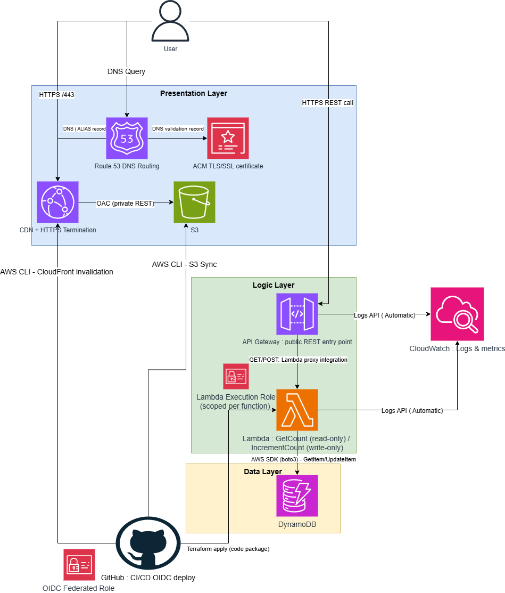

# Architecture Overview

Three-tier serverless architecture (Presentation / Logic / Data), with GitHub 
Actions handling CI/CD via OIDC-federated IAM roles.

## V-Model Position

This document is the **Architecture** stage artifact of the V-Model SDLC,
sitting between Requirements (`docs/requirements/`) and Implementation
(`infrastructure/`, `frontend/`, `backend/`). Every architectural
component below must trace back to one or more functional/non-functional
requirements once those are written.

## How a Request Flows

When someone visits the site, Route 53 resolves the domain to CloudFront, 
which serves the cached static files from S3 over HTTPS. The page's 
JavaScript then calls API Gateway directly to update and read back the 
visitor count — this is a separate call from the page load itself.
API Gateway routes GET /visitorCount and POST /visitorCount/increment to 
two separate Lambda functions — one read-only, one write-only — shown as 
a single icon in the diagram for brevity. Each function reads/writes the 
count in DynamoDB using its own scoped IAM role and returns it back up the 
chain to the browser.

Deployments are automated with GitHub Actions.
Frontend changes are synced to S3 and the CloudFront cache is invalidated.
Backend changes, including the Lambda code, are deployed by applying the Terraform configuration after
a manual approval, so Terraform remains the single source of truth for what runs in AWS.
Both pipelines authenticate with short-lived IAM roles instead of stored AWS credentials.
 

## Security

### HTTPS & Origin Access
CloudFront terminates HTTPS at the edge using an ACM certificate for the 
custom domain, so all traffic between the browser and CloudFront is 
encrypted. The S3 bucket itself has no public access at all — it's locked 
down to CloudFront only via Origin Access Control (OAC), instead of the 
more common approach of a public bucket policy. This way the only way to 
reach the site content is through CloudFront, not by hitting the bucket 
directly.

### Least-Privilege IAM
The Lambda function has its own execution role, scoped only to the specific 
DynamoDB actions it needs (read/write on one table) — not broad DynamoDB 
access. Deployments work the same way: GitHub Actions assumes a short-lived 
IAM role via OIDC federation rather than using stored AWS access keys, and 
that role is scoped to only the S3 bucket, Lambda function, and CloudFront 
distribution it needs to touch. Nothing in this project relies on long-lived 
credentials sitting anywhere.

## Design Decisions

### No VPC / Subnets
All AWS service communication (Lambda↔DynamoDB, GitHub Actions↔S3/Lambda, 
user↔API Gateway) uses AWS's public/managed service API endpoints, secured 
via IAM policies rather than network-boundary isolation. A VPC with public/
private subnets was evaluated — Lambda would sit in a private subnet, reach 
DynamoDB via a Gateway VPC Endpoint, with a NAT Gateway for any outbound 
internet needs.

This was not adopted because none of the services in this architecture 
require VPC placement to function (Lambda outside a VPC already reaches 
DynamoDB over AWS's managed network), and the added NAT Gateway cost and 
complexity aren't justified by this workload's threat model. IAM-based 
authorization provides the actual access control in both cases.

### DynamoDB over RDS
A visitor counter is just a single number keyed by page — no relationships, 
no complex queries, no need for SQL. DynamoDB fits that shape directly and 
comes with a generous free tier with no idle cost, unlike RDS which runs 
a database instance continuously whether it's being hit or not. RDS would 
be the right call if this project ever needed relational data (e.g. a blog 
with posts and comments), but for a single counter it would just be 
unnecessary overhead.

### Two Lambda Functions with Per-Function IAM
The read and write operations are implemented as separate Lambda functions:
`GetVisitorCount` reads the visitor count, while `IncrementVisitorCount`
updates it. Splitting these operations allows each function to scale, be
monitored, and be tested independently.

More importantly, separate functions allow genuinely separate IAM permissions.
The execution role for `GetVisitorCount` is granted only
`dynamodb:GetItem`, while the execution role for `IncrementVisitorCount` is
granted only `dynamodb:UpdateItem`. Neither function can perform the other's
operation, even though both target the same DynamoDB table. This avoids using
one broad execution role for both read and write access and better follows the
principle of least privilege.

### Lambda over EC2 / Fargate
The backend logic here is a couple of lines that run for milliseconds on 
each request — there's no long-running process, no need to manage a server, 
and traffic on a personal resume site is low and unpredictable. Lambda 
charges per invocation and scales to zero when nobody's visiting, which 
matches this workload a lot better than paying for an EC2 instance or 
Fargate task sitting idle most of the time.

### Terraform over AWS SAM / CDK
Chosen for job-market transferability — Terraform is cloud-agnostic and 
shows up far more often in job postings than SAM, which locks you into 
AWS-only tooling.

### API Gateway over a Lambda Function URL
A Lambda Function URL would work fine for this single endpoint and cuts 
out a service entirely — less to configure. API Gateway was chosen instead 
because it's the standard front door for REST APIs on AWS and gives 
room to grow (multiple routes, request validation, throttling, API keys) 
if the project ever adds more endpoints. It's also just a far more common 
pattern in real job postings, so it's worth the small extra setup for 
that alone.

### S3 + CloudFront over AWS Amplify Hosting
Amplify Hosting would handle the S3 bucket, CloudFront distribution, and 
CI/CD deploys automatically behind the scenes — less setup, but also less 
visible. Since the goal of this project is to demonstrate hands-on AWS 
skills, wiring up S3, CloudFront, and the deploy pipeline manually shows 
the actual underlying knowledge rather than relying on a managed 
abstraction that does it for you. Amplify would be the more sensible pick 
for a team shipping a real product quickly — just not for a project meant 
to prove you understand what's happening underneath.

## Tiers

### 1. Presentation Tier

- **Purpose:** Serves the static resume website to end users.
- **AWS Services:** Amazon S3 (static asset storage), Amazon CloudFront
  (CDN/edge distribution), AWS Certificate Manager (TLS certificate),
  Amazon Route 53 (DNS).
- **Terraform Module:** [`infrastructure/modules/presentation`](../../infrastructure/modules/presentation)
- **Related Requirements:** [FR1](../requirements/functional-requirements.md#fr1-public-resume-access), [FR2](../requirements/functional-requirements.md#fr2-resume-written-in-html), [FR3](../requirements/functional-requirements.md#fr3-resume-styled-with-css), [FR4](../requirements/functional-requirements.md#fr4-static-website-hosting-on-s3), [FR5](../requirements/functional-requirements.md#fr5-https-for-the-static-website), [FR6](../requirements/functional-requirements.md#fr6-cloudfront-cdn-distribution), [FR7](../requirements/functional-requirements.md#fr7-custom-dns-domain-name), [FR8](../requirements/functional-requirements.md#fr8-domain-pointed-to-cloudfront), [FR9](../requirements/functional-requirements.md#fr9-route-53-as-dns-provider), [FR10](../requirements/functional-requirements.md#fr10-visitor-counter-display), [FR11](../requirements/functional-requirements.md#fr11-visitor-counter-implemented-in-javascript), [NFR1](../requirements/non-functional-requirements.md#nfr1-high-availability)

### 2. Logic Tier

- **Purpose:** Exposes an API that mediates between the presentation tier
  and the data tier.
- **AWS Services:** Amazon API Gateway, AWS Lambda, IAM execution roles
  for Lambda.
- **Terraform Module:** [`infrastructure/modules/logic`](../../infrastructure/modules/logic)
- **Related Requirements:** [FR14](../requirements/functional-requirements.md#fr14-api-gateway-and-lambda-mediate-data-access), [FR15](../requirements/functional-requirements.md#fr15-lambda-function-code-in-python), [FR16](../requirements/functional-requirements.md#fr16-automated-tests-for-lambda-code), [NFR7](../requirements/non-functional-requirements.md#nfr7-automated-backend-testing)

### 3. Data Tier

- **Purpose:** Persists application state (e.g. visitor counter).
- **AWS Services:** Amazon DynamoDB.
- **Terraform Module:** [`infrastructure/modules/data`](../../infrastructure/modules/data)
- **Related Requirements:** [FR12](../requirements/functional-requirements.md#fr12-dynamodb-stores-visitor-count)

### Cross-Cutting Concerns

- **IAM:** Least-privilege roles/policies scoped per module; no shared
  broad-permission roles.
- **Observability:** Amazon CloudWatch (logs, metrics, alarms).
- **CI/CD:** GitHub Actions, authenticating to AWS via OIDC-federated IAM
  roles — no long-lived AWS credentials stored in source or secrets.
- **Related Requirements:** [FR13](../requirements/functional-requirements.md#fr13-no-direct-client-to-dynamodb-communication), [FR17](../requirements/functional-requirements.md#fr17-infrastructure-as-code-for-api-resources), [FR18](../requirements/functional-requirements.md#fr18-terraform-as-the-iac-tool), [FR19](../requirements/functional-requirements.md#fr19-automated-cicd-for-updates), [FR20](../requirements/functional-requirements.md#fr20-backend-github-repository), [FR21](../requirements/functional-requirements.md#fr21-cicd-for-backend-code), [FR22](../requirements/functional-requirements.md#fr22-frontend-github-repository), [FR23](../requirements/functional-requirements.md#fr23-cicd-for-frontend-code), [FR24](../requirements/functional-requirements.md#fr24-automatic-cloudfront-cache-invalidation), [FR25](../requirements/functional-requirements.md#fr25-logging-to-cloudwatch), [NFR2](../requirements/non-functional-requirements.md#nfr2-free-tier-cost-constraint), [NFR3](../requirements/non-functional-requirements.md#nfr3-no-public-write-access-to-data), [NFR4](../requirements/non-functional-requirements.md#nfr4-no-credentials-in-source-control), [NFR5](../requirements/non-functional-requirements.md#nfr5-infrastructure-as-code), [NFR6](../requirements/non-functional-requirements.md#nfr6-gated-cicd-auto-deploy), [NFR8](../requirements/non-functional-requirements.md#nfr8-oidc-federated-cicd-authentication), [NFR9](../requirements/non-functional-requirements.md#nfr9-billing-alarm)

## Module Boundaries

Modules under `infrastructure/modules/` do not reference each other
directly. Each module exposes inputs (`variables.tf`) and outputs
(`outputs.tf`) only; wiring between tiers happens explicitly in
[`infrastructure/environments/prod/main.tf`](../../infrastructure/environments/prod/main.tf).
