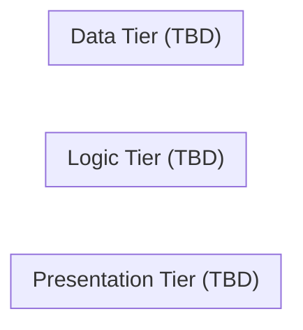

# Three-Tier Architecture Diagram

> **Status:** Placeholder. No diagram has been created yet.

## Purpose

This file will hold (or link to) a visual diagram of the three-tier
architecture described in
[`architecture-overview.md`](./architecture-overview.md):

- Presentation tier (S3, CloudFront, ACM, Route 53)
- Logic tier (API Gateway, Lambda, IAM execution roles)
- Data tier (DynamoDB)
- Cross-cutting concerns (IAM, CloudWatch, CI/CD via GitHub Actions/OIDC)

## Suggested Format

- Prefer a Mermaid diagram embedded directly in Markdown (renders natively
  on GitHub) or a `.drawio`/`.png`/`.svg` export stored alongside this
  file.

## Placeholder

